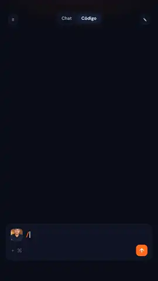

# effects with claude

**18 motion-graphics effects for talking-head videos — and the text behind you stays readable.**

Drop in a vertical clip of yourself (camera, phone or AI avatar), pick an effect, and get pro edits: words that rise
*behind* your head, glass stat cards around you, a chart that towers over you, your reels orbiting you in 3D, lights-out
neon, before/after camera pushes and more. It runs on your machine and works as a **Claude Code skill**, so you can just
ask: *"put a giant FOCUS behind me at 0:04"*.

<p align="center"></p>

## Why the text stays readable

Most "text behind the subject" edits hide half the word behind your head. Here every effect knows where your head is
on every frame (face track + a clean portrait cut-out), so:

- words are sized and placed **above your head line**, and your head only overlaps the bottom of the letters;
- if your framing has no headroom (the usual phone / avatar close-up), the shot **slides down by itself** and the wall
  is extended by stretching the top strip of your own background — it reads as more wall, not as a blur box;
- cards placed behind you start under your hair and slide out, with the text aligned on the visible side.

## The effects

| | | | |
|:-:|:-:|:-:|:-:|
| <br>`giant-word-behind`<br><sub>A giant word drops in behind your head</sub> | <br>`glass-widgets`<br><sub>Glass stat cards, one behind you, a follow pill</sub> | <br>`chart-behind`<br><sub>Bars rise behind you, the top one gets circled</sub> | <br>`shoulder-compare`<br><sub>Camera pushes to Before, whips to After</sub> |
| <br>`spotlight`<br><sub>Lights out, rim light, neon word behind you</sub> | <br>`card-orbit`<br><sub>Your reels orbit your head in 3D</sub> | <br>`punch-in`<br><sub>Hard zoom on a word, room goes soft</sub> | <br>`grade-wipe`<br><sub>Flat LOG wiped into a cinematic grade</sub> |
| <br>`face-lock`<br><sub>Brackets snap onto your face and track it</sub> | <br>`freeze-sticker`<br><sub>Freeze, grey room, you as a sticker</sub> | <br>`name-tag`<br><sub>Lower-third with your name and handle</sub> | <br>`kinetic-captions`<br><sub>Word-by-word captions, key word behind you</sub> |
| <br>`stat-card`<br><sub>Repo-style card, the number rolls up</sub> | <br>`strike`<br><sub>Old value struck through, new one drops in</sub> | <br>`hand-draw`<br><sub>Marker arrow and loop around your face</sub> | <br>`scramble-title`<br><sub>A title decodes behind your head</sub> |
| <br>`photo-burst`<br><sub>Polaroids slap onto the wall behind you</sub> | <br>`comment-cta`<br><sub>"Comment WORD" ending + DM notification</sub> | | |

Each effect's options are listed at the top of `effects/<name>/effect.js`; `examples/` has a ready plan for every one.

## Quick start

Needs **Python 3.10+**, **ffmpeg** on your PATH and ~400 MB for Chromium and the models. Windows, macOS and Linux.

```bash
git clone https://github.com/rogelioserrano11/effectswithclaude
cd effectswithclaude
./install.sh            # Windows: powershell -ExecutionPolicy Bypass -File install.ps1
```

The installer creates `.venv`, downloads the models, GSAP and fonts (pinned by checksum), installs Chromium for
rendering, links the folder as a Claude Code skill and prints `READY`.

```bash
# one effect on one moment of your clip
.venv/bin/python -m efx fx giant-word-behind me.mp4 --at 4 --dur 3 --param word=FOCUS

# several effects, one render (see examples/reel.json)
.venv/bin/python -m efx build plan.json            # add --scale 0.5 for a fast draft
.venv/bin/python -m efx list                        # every effect, one line each
```

On Windows use `.venv\Scripts\python` instead of `.venv/bin/python`.

### A plan

```json
{
  "clip": "me.mp4",
  "out": "final.mp4",
  "brand": { "accent": "#ff6b1a", "handle": "@yourhandle" },
  "effects": [
    { "fx": "giant-word-behind", "at": 1.0, "dur": 3.0, "params": { "word": "FOCUS" } },
    { "fx": "glass-widgets",     "at": 6.5, "dur": 3.5, "params": { "views": 189000 } },
    { "fx": "comment-cta",       "at": 14,  "dur": 3.5, "params": { "word": "GUIDE" } }
  ]
}
```

Your audio is kept untouched; only the effect windows are re-rendered. Brand options: `accent`, `accent2`, `text`, `bg`,
`handle`, and `fonts: {display, body, mono}` with paths to your own `.ttf` files.

## With Claude Code

After `install`, the folder is linked as the `effectswithclaude` skill. Open Claude Code next to your clip and ask in
plain words: *"use effectswithclaude: name tag at the start, a chart of my top reels at 0:08 and end with comment GUIDE"*.
Claude writes the plan, renders a half-size draft, checks frames and then renders the final. See `SKILL.md`.

## How it works

1. **prep** — ffmpeg extracts the effect window; MODNet cuts you out (portrait alpha, smoothed across frames) and YuNet
   tracks your face; the top of your head is measured on every frame.
2. **render** — each frame is a web page: your frame, a layer *behind* you, you (cut out), a layer *in front*, and a
   screen layer. One paused GSAP timeline is seeked frame by frame in headless Chromium, so renders are deterministic.
3. **build** — the rendered windows are laid back over your clip with your original audio.

Want your own effect? Copy any folder in `effects/` — the runtime API is documented in `docs/writing-effects.md`.

## Credits

Inspired by the idea of drop-in talking-head effects for Claude Code shared by
[aaksa/facecammaxxing](https://github.com/aaksa/facecammaxxing) and
[claude-video-effects](https://github.com/Vibha-Ramprakash/claude-video-effects) by Vibha Ramprakash. This project is an
independent implementation (HTML/GSAP in Chromium, no code taken from either).

Models and libraries, downloaded at setup and not bundled: MODNet (Apache-2.0), YuNet / OpenCV Zoo (Apache-2.0),
GSAP (GreenSock standard license), Anton, Inter and JetBrains Mono (SIL OFL). See `NOTICE.md`.

Made by [@rogelioserrano.ai](https://instagram.com/rogelioserrano.ai) · powered by INSPYRIA. MIT licensed.
